## 1. Overall Logic

The warning system runs an event-driven cycle on every GPS fix delivered to the client browser (or replay harness). It tracks the vehicle's position along a pre-built road corridor, predicts demands for upcoming curves, resolves advisory speeds, computes required deceleration, and issues graded visual, acoustic, and voice warnings.

```
GPS Fix (Lat, Lon, Acc, Speed, Heading)
  │
  ▼
[Motion Estimator] ──▶ Gating (Accuracy <= 40m) & Exponential Smoothing
  │
  ▼
[Look-Ahead & Corridor Check] ──▶ Dynamic Look-Ahead Distance; Request / Refresh Corridor
  │
  ▼
[Corridor Tracker] ──▶ Project Fix onto Corridor Polyline (Continuity Search Window)
  │
  ▼
[Curve Projection & Filtering] ──▶ Locate Curves Ahead; Tag In-Curve vs Approach
  │
  ▼
[Governing Curve Selector] ──▶ Calculate Advisory Speeds; Score Urgency (a_req) for All Curves
  │
  ▼
[Alert Classification] ──▶ Hysteresis Classifier (None / Advisory / Warning / Brake)
  │
  ▼
[Warning Presentation] ──▶ Minimum 2s Hold, Escalation-Only Tone / TTS, In-Curve Wording
```

### End-to-End Pipeline Execution Flow

1. **GPS Input Ingestion & Gating ([`MotionEstimator.update`](file:///d:/Projects/In-Vehicle-Speed-Warning-System-Part-5/lib/pipeline.js#L355-L419))**:
   - The browser `navigator.geolocation.watchPosition` callback passes coordinates (`coords.latitude`, `coords.longitude`, `coords.accuracy`, `coords.speed`, `coords.heading`) and `timestamp`.
   - **Accuracy Check**: If `coords.accuracy > 40 m`, the fix is flagged as unusable (`usable = false`). It is discarded from speed and heading derivations, and **never saved as the previous baseline** to avoid corrupting subsequent differential measurements.
   - **Speed Derivation**: If hardware Doppler speed `coords.speed` is provided ($\ge 0$), it is converted to km/h (`speed * 3.6`). If `coords.speed` is null, speed is derived by computing the great-circle displacement ([`distanceMetres`](file:///d:/Projects/In-Vehicle-Speed-Warning-System-Part-5/lib/geo.js#L16-L22)) over the elapsed time ($\Delta t \in (0.2\text{ s}, 15\text{ s})$), rejecting instantaneous jumps exceeding $70\text{ m/s}$ ($252\text{ km/h}$). The result is smoothed with an exponential filter ($\alpha = 0.4$).
   - **Heading Derivation**: If hardware heading is absent, speed $> 5\text{ km/h}$, and displacement $> 3\text{ m}$, heading is computed via [`bearingDegrees`](file:///d:/Projects/In-Vehicle-Speed-Warning-System-Part-5/lib/geo.js#L25-L32). If speed $< 3\text{ km/h}$, heading is frozen to reject standstill wander.

2. **Look-Ahead Window Calculation ([`requiredLookAheadMetres`](file:///d:/Projects/In-Vehicle-Speed-Warning-System-Part-5/lib/safespeed.js#L293-L302))**:
   - The look-ahead distance scales quadratically with speed to guarantee sufficient warning distance:
     $$d_{\text{lookahead}} = \text{clamp}\left(300, 1500, 2.0 \cdot \left[v \cdot t_{\text{reaction}} + \frac{v^2}{2 \cdot a_{\text{comfortable}}}\right]\right)$$
     with $t_{\text{reaction}} = 1.2\text{ s}$ and $a_{\text{comfortable}} = 1.5\text{ m/s}^2$.

3. **Corridor Refresh Decision ([`CorridorTracker.needsRefresh`](file:///d:/Projects/In-Vehicle-Speed-Warning-System-Part-5/lib/pipeline.js#L328-L335))**:
   - The client tests if new road geometry must be fetched from the server (`/api/road-ahead`):
     - Triggered if no corridor is loaded or current match is invalid.
     - Triggered if `atNetworkEnd === true` and remaining corridor $< 50\text{ m}$.
     - Triggered if remaining corridor $< 0.6 \cdot d_{\text{lookahead}}$.
   - Network requests are rate-limited and sequence-guarded: minimum fetch interval of $4\text{ s}$, backoff of $20\text{ s}$ on network error, hard timeout of $8\text{ s}$, and abort controller cancellation of out-of-sequence responses.

4. **Corridor Projection & Map Matching ([`CorridorTracker.locate`](file:///d:/Projects/In-Vehicle-Speed-Warning-System-Part-5/lib/pipeline.js#L257-L316))**:
   - The GPS point is converted into the corridor’s local tangent plane ([`createLocalFrame`](file:///d:/Projects/In-Vehicle-Speed-Warning-System-Part-5/lib/geo.js#L47-L69)).
   - The position is projected onto the polyline segments via [`projectOntoPolyline`](file:///d:/Projects/In-Vehicle-Speed-Warning-System-Part-5/lib/geo.js#L98-L142).
   - **Continuity Search Window**: To prevent jumping to opposite carriageways or hairpin legs, the search is constrained to:
     $$[\text{lastDistanceAlong} - 25\text{ m},\; \text{lastDistanceAlong} + \min(1000\text{ m}, 30 + 60 \cdot \Delta t)]$$
   - A match is valid if perpendicular cross-track offset $\le 45\text{ m}$ and corridor age $\le 180\text{ s}$.

5. **Curve Identification Ahead ([`CorridorTracker.locate`](file:///d:/Projects/In-Vehicle-Speed-Warning-System-Part-5/lib/pipeline.js#L292-L306))**:
   - For every curve recorded on the corridor:
     $$\text{distanceAhead} = \text{startDistance} - \text{distanceAlong}$$
     $$\text{distanceToExit} = \text{endDistance} - \text{distanceAlong}$$
   - Any curve with $\text{distanceToExit} \le 0$ (already passed) is discarded.
   - If $\text{distanceAhead} \le 0$, the vehicle is inside the curve: $\text{inCurve} = \text{true}$ and $\text{distanceAhead} = 0$.

6. **Governing Curve Selection ([`selectGoverningCurve`](file:///d:/Projects/In-Vehicle-Speed-Warning-System-Part-5/lib/safespeed.js#L268-L286))**:
   - Rather than selecting the nearest curve (which could mask a severe curve just beyond a mild bend), the system scores **every curve** in the look-ahead window.
   - For each curve, the advisory speed $V_a$ is solved and the urgency/required deceleration $a_{\text{req}}$ is evaluated.
   - The curve with the maximum $a_{\text{req}}$ is selected as the governing curve. Ties are broken by choosing the curve with the smaller $\text{distanceAhead}$.

7. **Warning Classification ([`classifyAlert`](file:///d:/Projects/In-Vehicle-Speed-Warning-System-Part-5/lib/safespeed.js#L249-L257))**:
   - Evaluates $a_{\text{req}}$ against hysteresis thresholds (`brake`: $2.8 / 2.2\text{ m/s}^2$, `warning`: $1.5 / 1.1\text{ m/s}^2$, `advisory`: $0.7 / 0.5\text{ m/s}^2$).

8. **Warning Presentation & Sound/Speech Trigger ([`setAlert`](file:///d:/Projects/In-Vehicle-Speed-Warning-System-Part-5/public/index.js#L319-L349))**:
   - Applies a **minimum display hold** of $2000\text{ ms}$ on downgrades to prevent flickering.
   - Triggers audio tones and speech synthesis **only upon escalation** (rank increase).
   - Switches display and voice phrasing between approach mode and in-curve mode.

---

## 2. Formulas & Calculations

### Formula 1: Speed-Dependent Look-Ahead Distance
Implemented in [`requiredLookAheadMetres`](file:///d:/Projects/In-Vehicle-Speed-Warning-System-Part-5/lib/safespeed.js#L293-L302):
$$d_{\text{lookahead}} = \min\left(1500,\; \max\left(300,\; 2.0 \cdot \left[v \cdot t_{\text{reaction}} + \frac{v^2}{2 \cdot a_{\text{comfort}}}\right]\right)\right)$$
- **Variables**:
  - $v$: Vehicle current speed in m/s ($v = \max(0, V_{\text{km/h}}) / 3.6$).
  - $t_{\text{reaction}}$: Driver perception-reaction time ($1.2\text{ s}$).
  - $a_{\text{comfort}}$: Comfortable deceleration budget ($1.5\text{ m/s}^2$).
  - $2.0$: Look-ahead safety multiplier (ensures geometry is in memory before an advisory threshold is reached).
- **Purpose**: Dynamically sizes the corridor geometry request so the vehicle never enters a curve before geometry has been analysed.

---

### Formula 2: Side-Friction Factor $f(V)$
Implemented in [`sideFriction`](file:///d:/Projects/In-Vehicle-Speed-Warning-System-Part-5/lib/safespeed.js#L61-L76):
- **IRC Model (Default)**:
  $$f = 0.15 \quad (\text{constant for all } V)$$
  Per Indian Road Congress standards IRC:73 / IRC:38, $0.15$ is the maximum allowable design side-friction factor for rural highways.
- **AASHTO Model (Sensitivity Analysis)**:
  Linearly interpolated piecewise table from $0.17$ at $30\text{ km/h}$ to $0.09$ at $120\text{ km/h}$:
  $$f(V) = f_i + \frac{V - V_i}{V_{i+1} - V_i} (f_{i+1} - f_i)$$
- **Purpose**: Establishes the lateral tire-pavement friction coefficient budgeted for comfortable curve negotiation.

---

### Formula 3: IRC Design-Implied Superelevation $e$
Implemented in [`ircSuperelevation`](file:///d:/Projects/In-Vehicle-Speed-Warning-System-Part-5/lib/superelevation.js#L91-L120):
$$e_{\text{raw}} = \frac{V_d^2}{225 \cdot R}, \qquad e = \min(e_{\text{max}}, e_{\text{raw}})$$
- **Variables**:
  - $V_d$: Highway design speed in km/h (selected from IRC:73 based on road classification: NH, SH, MDR, ODR, VR and terrain: plain, rolling, mountainous, steep). Default is $65\text{ km/h}$ for State Highway in rolling terrain under minimum design basis.
  - $R$: Curve radius in metres.
  - $e_{\text{max}}$: Superelevation cap ($0.07$ for plain/rolling terrain, $0.10$ for mountainous/steep terrain).
  - $225$: Factor derived from banking to counteract $100\%$ of centrifugal acceleration at $75\%$ of design speed with zero friction:
    $$e = \frac{(0.75 V_d / 3.6)^2}{g \cdot R} = \frac{0.5625 \cdot V_d^2}{12.96 \cdot 9.81 \cdot R} \approx \frac{V_d^2}{226 \cdot R} \approx \frac{V_d^2}{225 \cdot R}$$
- **Substandard Check**:
  $$f_{\text{demand}} = \frac{V_d^2}{127 \cdot R} - e_{\text{max}}$$
  If $f_{\text{demand}} > 0.15$, the curve is flagged as `substandard`, and IRC restricts speed to:
  $$V_{\text{restricted}} = \sqrt{127 \cdot R \cdot (e_{\text{max}} + 0.15)}$$
- **Purpose**: Calculates the realistic physical banking of the road without assuming an unsafe flat road ($0\%$) or an over-optimistic uniform $7\%$.

---

### Formula 4: Advisory Speed $V_a$
Implemented in [`advisorySpeedKmh`](file:///d:/Projects/In-Vehicle-Speed-Warning-System-Part-5/lib/safespeed.js#L103-L131):
$$V_a = \sqrt{127 \cdot R \cdot \max(0.02,\; e + f(V_a))}$$
- **Variables**:
  - $V_a$: Advisory speed in km/h.
  - $R$: Curve radius in metres.
  - $e$: Superelevation as a decimal (e.g., $0.07$).
  - $f(V_a)$: Side friction factor.
  - $127$: Unit conversion constant ($127 \approx 3.6^2 \cdot g = 12.96 \cdot 9.81$).
- **Solver**: Under IRC ($f = 0.15$), this reduces to the closed form $V_a = \sqrt{127 \cdot R \cdot (e + 0.15)}$. For AASHTO $f(V)$, the system uses **bisection over 60 iterations** on $[0.1, 400]\text{ km/h}$ to find the unique root of:
  $$g(V) = V - \sqrt{127 \cdot R \cdot \max(0.02, e + f(V))} = 0$$
- **Purpose**: Solves the maximum design-consistent speed where lateral acceleration matches driver comfort boundaries.

---

### Formula 5: Usable Braking Distance & Deceleration Criterion
Implemented in [`requiredDeceleration`](file:///d:/Projects/In-Vehicle-Speed-Warning-System-Part-5/lib/safespeed.js#L158-L165):
$$d_{\text{usable}} = d - v \cdot t_{\text{reaction}}$$
$$a_{\text{req}} = \begin{cases} 
0 & \text{if } V \le V_a \\ 
9.81 & \text{if } d_{\text{usable}} \le 0 \\ 
\min\left(9.81,\; \dfrac{v^2 - v_a^2}{2 \cdot d_{\text{usable}}}\right) & \text{if } d_{\text{usable}} > 0 
\end{cases}$$
- **Variables**:
  - $v$: Vehicle current speed in m/s ($V_{\text{km/h}} / 3.6$).
  - $v_a$: Curve advisory speed in m/s ($V_{a,\text{km/h}} / 3.6$).
  - $d$: Distance to curve entry in metres ($\text{distanceAhead}$).
  - $t_{\text{reaction}}$: Reaction time ($1.2\text{ s}$).
- **Purpose**: Measures the exact constant deceleration required to arrive at the curve entry at advisory speed after factoring in perception-reaction delay.

---

### Formula 6: Continuous Urgency Score
Implemented in [`curveUrgency`](file:///d:/Projects/In-Vehicle-Speed-Warning-System-Part-5/lib/safespeed.js#L186-L204):
$$d_{\text{rawUsable}} = d - v \cdot t_{\text{reaction}}$$
$$d_{\text{usable}} = \max(15.0,\; d_{\text{rawUsable}})$$
$$a_{\text{braking}} = \frac{v^2 - v_a^2}{2 \cdot d_{\text{usable}}}$$
$$a_{\text{lateral}} = \begin{cases} 
\left[\left(\dfrac{V}{V_a}\right)^2 - 1\right] \cdot 2.5 & \text{if } d_{\text{rawUsable}} < 15.0 \\ 
0 & \text{if } d_{\text{rawUsable}} \ge 15.0 
\end{cases}$$
$$\text{Urgency} = \min\left(9.81,\; \max(a_{\text{braking}},\; a_{\text{lateral}},\; 0)\right)$$
- **Variables**:
  - $15.0\text{ m}$ (`MIN_USABLE_DISTANCE_METRES`): Usable distance floor. Without this floor, the braking term diverges ($a_{\text{req}} \to \infty$) as $d_{\text{usable}} \to 0$, causing false emergency stops for minor speed exceedances.
  - $a_{\text{lateral}}$: Lateral acceleration overshoot floor. Scaled by $2.5$ so it matches deceleration units ($\text{m/s}^2$). Engages **only when committed** ($d_{\text{rawUsable}} < 15\text{ m}$).
- **Purpose**: Combines longitudinal stopping urgency and lateral curve overshoot into a single monotonic, non-collapsing metric across the curve entry boundary.

---

## 3. Comparisons & Thresholds

| Metric / Parameter | Value / Formula | Compared With | Type of Comparison | Source File & Location |
| :--- | :--- | :--- | :--- | :--- |
| **GPS Accuracy Gate** | `coords.accuracy` | $\le 40\text{ m}$ | Absolute threshold | [`MotionEstimator.update`](file:///d:/Projects/In-Vehicle-Speed-Warning-System-Part-5/lib/pipeline.js#L357) |
| **Plausible Speed Jump** | $\Delta d / \Delta t$ | $< 70\text{ m/s}$ ($252\text{ km/h}$) | Kinematic feasibility limit | [`MotionEstimator.update`](file:///d:/Projects/In-Vehicle-Speed-Warning-System-Part-5/lib/pipeline.js#L383) |
| **Minimum Moving Speed** | `speedKmh` | $> 5\text{ km/h}$ (heading), $> 3\text{ km/h}$ (drift) | Absolute threshold | [`MotionEstimator.update`](file:///d:/Projects/In-Vehicle-Speed-Warning-System-Part-5/lib/pipeline.js#L394-L404) |
| **Map Match Cross-Track** | `projection.offset` | $\le 45\text{ m}$ | Absolute perpendicular tolerance | [`CorridorTracker.locate`](file:///d:/Projects/In-Vehicle-Speed-Warning-System-Part-5/lib/pipeline.js#L281) |
| **Corridor Expiry Time** | `now - receivedAt` | $\le 180{,}000\text{ ms}$ (3 minutes) | Absolute time limit | [`CorridorTracker.locate`](file:///d:/Projects/In-Vehicle-Speed-Warning-System-Part-5/lib/pipeline.js#L281) |
| **Corridor Refresh Threshold**| `remainingMetres` | $< 0.6 \cdot d_{\text{lookahead}}$ (or $< 50\text{ m}$ if at end)| Ratio comparison vs dynamic look-ahead | [`CorridorTracker.needsRefresh`](file:///d:/Projects/In-Vehicle-Speed-Warning-System-Part-5/lib/pipeline.js#L332-L333) |
| **Speed Exceedance Gate** | `speedKmh` | $> \text{advisoryKmh}$ | Strict inequality | [`curveUrgency`](file:///d:/Projects/In-Vehicle-Speed-Warning-System-Part-5/lib/safespeed.js#L187) |
| **Commitment Boundary** | $d - v \cdot t_{\text{reaction}}$ | $< 15\text{ m}$ | Absolute distance threshold | [`curveUrgency`](file:///d:/Projects/In-Vehicle-Speed-Warning-System-Part-5/lib/safespeed.js#L199) |
| **Alert Level: BRAKE** | `requiredDeceleration` | **Trigger**: $\ge 2.8\text{ m/s}^2$<br>**Release**: $\ge 2.2\text{ m/s}^2$ | Hysteresis threshold | [`ALERT_LEVELS`](file:///d:/Projects/In-Vehicle-Speed-Warning-System-Part-5/lib/safespeed.js#L213) |
| **Alert Level: WARNING** | `requiredDeceleration` | **Trigger**: $\ge 1.5\text{ m/s}^2$<br>**Release**: $\ge 1.1\text{ m/s}^2$ | Hysteresis threshold | [`ALERT_LEVELS`](file:///d:/Projects/In-Vehicle-Speed-Warning-System-Part-5/lib/safespeed.js#L214) |
| **Alert Level: ADVISORY**| `requiredDeceleration` | **Trigger**: $\ge 0.7\text{ m/s}^2$<br>**Release**: $\ge 0.5\text{ m/s}^2$ | Hysteresis threshold | [`ALERT_LEVELS`](file:///d:/Projects/In-Vehicle-Speed-Warning-System-Part-5/lib/safespeed.js#L215) |
| **Minimum Display Hold** | `now - alertSince` | $\ge 2000\text{ ms}$ | Time debounce on downgrade | [`setAlert`](file:///d:/Projects/In-Vehicle-Speed-Warning-System-Part-5/public/index.js#L326) |

---

## 4. Exact Warning Trigger

### 1. Multi-Condition Logic
For an alert to be issued, **all** of the following conditions must evaluate to `TRUE` (**AND logic**):
1. `motion.usable === true` (GPS accuracy $\le 40\text{ m}$).
2. `located.valid === true` (Vehicle matched to corridor polyline with cross-track offset $\le 45\text{ m}$ and corridor age $\le 180\text{ s}$).
3. At least one curve exists ahead where $\text{distanceToExit} > 0$.
4. Vehicle speed $V > V_a$ for the governing curve.
5. Calculated urgency $a_{\text{req}} \ge \text{threshold}$ for the target level (where threshold is `trigger` if escalating, or `release` if maintaining/downgrading).

### 2. Immediate vs. Persisted Triggering
- **Visual Alert**: Triggers **immediately** on the very first GPS update that satisfies the conditions.
- **Visual Downgrade / Clearance**: **Delayed**. Any downgrade in visual alert level (e.g., Brake $\to$ Warning, or Advisory $\to$ None) is blocked until the higher alert has been visible for at least $2000\text{ ms}$ (`MIN_ALERT_MS`).

### 3. Audio & Speech Escalation-Only Policy
In [`setAlert`](file:///d:/Projects/In-Vehicle-Speed-Warning-System-Part-5/public/index.js#L344):
```javascript
if (changed && nextRank > previousRank) {
  playTone(alert.level);
  announce(alert, governing);
}
```
- **Escalation-Only**: Auditory chimes and speech synthesis trigger **only when `nextRank > previousRank`**.
- **No Sound on De-escalation**: When a driver brakes and deceleration drops from $3.0\text{ m/s}^2$ to $1.2\text{ m/s}^2$, the system transitions silently from `brake` to `warning` without beeping or speaking.

### 4. Audio Tones
- **Advisory**: 1 beep at $480\text{ Hz}$ ($0.16\text{ s}$).
- **Warning**: 2 beeps at $660\text{ Hz}$, $100\text{ ms}$ vibration.
- **Brake**: 3 beeps at $880\text{ Hz}$, pattern vibration `[120, 60, 120] ms`.

### 5. Voice Speech Deduplication Logic
In [`announce`](file:///d:/Projects/In-Vehicle-Speed-Warning-System-Part-5/public/index.js#L372-L392):
- A speech token is created:
  $$\text{token} = \texttt{"\{radius\}@\{startDistance\}:\{level\}:\{inCurve ? 'in' : 'approach'\}"}$$
- If `state.announcedFor === token`, the speech utterance is suppressed.
- **Crucial Design Rule**: `state.announcedFor` is **not reset** when the alert level clears to `none`. This prevents repeat chatter if a driver hovers near the release/trigger boundary.

---

## 5. Step-by-Step Examples

### Example 1: High-Speed Approach to a Moderate Curve
- **Parameters**:
  - Curve radius $R = 155\text{ m}$, IRC design superelevation $e = 0.07$.
  - Approach speed: $V = 90\text{ km/h}$ ($v = 25.0\text{ m/s}$).
  - Reaction time: $t_r = 1.2\text{ s}$. Distance traveled during reaction: $v \cdot t_r = 30.0\text{ m}$.
  - Initial system state: `previousLevel = 'none'`.

#### Step 1: Compute Advisory Speed
$$V_a = \sqrt{127 \cdot 155 \cdot (0.07 + 0.15)} = \sqrt{19685 \cdot 0.22} = \sqrt{4330.7} \approx 65.81\text{ km/h} \quad (v_a = 18.28\text{ m/s})$$

#### Scenario 1A: At Distance $d = 200\text{ m}$
1. Speed check: $90 > 65.81$ (True).
2. Usable distance: $d_{\text{rawUsable}} = 200 - 30.0 = 170.0\text{ m} \ge 15.0\text{ m} \implies d_{\text{usable}} = 170.0\text{ m}$.
3. Required deceleration:
   $$a_{\text{req}} = \frac{v^2 - v_a^2}{2 \cdot d_{\text{usable}}} = \frac{25.0^2 - 18.28^2}{2 \cdot 170.0} = \frac{625.0 - 334.16}{340.0} = \frac{290.84}{340.0} \approx 0.855\text{ m/s}^2$$
4. Lateral term: $d_{\text{rawUsable}} \ge 15.0 \implies a_{\text{lateral}} = 0$.
5. Urgency: $\min(9.81, \max(0.855, 0, 0)) = 0.855\text{ m/s}^2$.
6. Classification from `'none'`:
   - Check `brake` ($\ge 2.8$): False.
   - Check `warning` ($\ge 1.5$): False.
   - Check `advisory` ($\ge 0.7$): **True** ($0.855 \ge 0.7$).
7. **Action**: Escalates `none` $\to$ `advisory`.
   - UI banner: `"Curve ahead — 66 km/h in 200 m"`.
   - Audio: 1 chime at $480\text{ Hz}$.
   - Speech: `"Curve ahead. 66"`.

#### Scenario 1B: At Distance $d = 70\text{ m}$ (Driver has not slowed down)
1. Usable distance: $d_{\text{rawUsable}} = 70 - 30.0 = 40.0\text{ m} \ge 15.0\text{ m} \implies d_{\text{usable}} = 40.0\text{ m}$.
2. Required deceleration:
   $$a_{\text{req}} = \frac{290.84}{2 \cdot 40.0} = \frac{290.84}{80.0} \approx 3.636\text{ m/s}^2$$
3. Urgency: $3.636\text{ m/s}^2$.
4. Classification from `'advisory'`:
   - Check `brake`: Previous rank is $1$, brake rank is $3$ ($3 > 1 \implies$ trigger $2.8\text{ m/s}^2$). Since $3.636 \ge 2.8$, **`brake` is selected**.
5. **Action**: Escalates `advisory` $\to$ `brake`.
   - UI banner: `"BRAKE — 66 km/h in 70 m"`.
   - Audio: 3 sharp beeps at $880\text{ Hz}$ + dual vibration.
   - Speech: `"Brake. Curve 66"`.

---

### Example 2: Compliant Driver Approaching a Curve
- **Parameters**:
  - Curve radius $R = 230\text{ m}$, $e = 0.07$.
  - Approach speed: $V = 75\text{ km/h}$.
  - Distance: $d = 120\text{ m}$.

1. Compute Advisory Speed:
   $$V_a = \sqrt{127 \cdot 230 \cdot (0.07 + 0.15)} = \sqrt{29210 \cdot 0.22} = \sqrt{6426.2} \approx 80.16\text{ km/h}$$
2. Speed Check:
   Is $V > V_a$? $75 > 80.16$ is **FALSE**.
3. In [`curveUrgency`](file:///d:/Projects/In-Vehicle-Speed-Warning-System-Part-5/lib/safespeed.js#L187):
   `if (!(speedKmh > advisoryKmh)) return 0;`
4. Urgency returns $0\text{ m/s}^2$.
5. Classification: `classifyAlert(0, 'none')` evaluates $0 < 0.7 \implies \mathbf{'none'}$.
6. **Result**: **No warning generated**. System remains silent; UI displays driving telemetry without alerts.

---

### Example 3: Driver Exceeding Speed Mid-Curve (In-Curve Protection)
- **Parameters**:
  - Sharp curve $R = 90\text{ m}$, $e = 0.07$.
  - Advisory speed:
    $$V_a = \sqrt{127 \cdot 90 \cdot 0.22} = \sqrt{2514.6} \approx 50.15\text{ km/h} \quad (v_a = 13.93\text{ m/s})$$
  - Current vehicle speed: $V = 65\text{ km/h}$ ($v = 18.06\text{ m/s}$).
  - Vehicle position: Inside the curve ($d = 0\text{ m}$, $\text{distanceToExit} = 45\text{ m}$).
  - `inCurve = true`.

1. Raw usable distance:
   $$d_{\text{rawUsable}} = 0 - 18.06 \cdot 1.2 = -21.67\text{ m}$$
2. Clamped usable distance:
   $$d_{\text{usable}} = \max(15.0,\; -21.67) = 15.0\text{ m}$$
3. Clamped braking term:
   $$a_{\text{braking}} = \frac{18.06^2 - 13.93^2}{2 \cdot 15.0} = \frac{326.16 - 194.04}{30.0} = \frac{132.12}{30.0} = 4.404\text{ m/s}^2$$
4. Lateral overshoot term ($d_{\text{rawUsable}} < 15.0$ engages lateral calculation):
   $$a_{\text{lateral}} = \left[\left(\frac{65}{50.15}\right)^2 - 1\right] \cdot 2.5 = [1.296^2 - 1] \cdot 2.5 = (1.68 - 1) \cdot 2.5 = 1.70\text{ m/s}^2$$
5. Final urgency:
   $$\text{Urgency} = \min(9.81,\; \max(4.404,\; 1.70,\; 0)) = 4.404\text{ m/s}^2$$
6. Classification:
   $4.404 \ge 2.8 \implies \mathbf{'brake'}$.
7. Label & Instruction Lookup ([`alertLabel`](file:///d:/Projects/In-Vehicle-Speed-Warning-System-Part-5/lib/safespeed.js#L236-L242)):
   Because `inCurve === true`, the instruction `"BRAKE"` is suppressed (braking while cornering consumes tire adhesion budget and can induce spin). Instead, [`IN_CURVE_LABELS['brake']`](file:///d:/Projects/In-Vehicle-Speed-Warning-System-Part-5/lib/safespeed.js#L231) is selected:
   - UI banner: `"Too fast — ease off — 50 km/h for this curve"`.
   - Speech utterance: `"Too fast. Ease off. 50"`.

---

## 6. What Is Done Well

1. **Deceleration & Urgency Formulation Over Magic Distance Gates**:
   - Replacing fixed distance triggers (such as 200 m) with $a_{\text{req}} = (v^2 - v_a^2)/(2(d - v t_r))$ ensures alerts fire hundreds of metres earlier at highway speeds ($110\text{ km/h}$) and avoid prematurely alerting in low-speed urban curves.
2. **Commitment Clamping Over Formula Switching**:
   - Flooring $d_{\text{usable}}$ at $15\text{ m}$ and using the lateral overshoot term as a $\max$ floor prevents the "commitment cliff" where urgency previously collapsed from $8.27\text{ m/s}^2$ to $1.39\text{ m/s}^2$ at the curve entrance.
3. **Escalation-Only Acoustic & Speech Alerting**:
   - Gating audio and speech behind `nextRank > previousRank` prevents alerting drivers while they are decelerating correctly.
4. **Governing Curve Selection Across Full Look-Ahead**:
   - Evaluating all curves ahead prevents a mild bend $30\text{ m}$ ahead from masking a dangerous hairpin $150\text{ m}$ away.
5. **Continuous Local Corridor Projection**:
   - The [`CorridorTracker`](file:///d:/Projects/In-Vehicle-Speed-Warning-System-Part-5/lib/pipeline.js#L197-L335) projects live fixes onto polyline segments at runtime with a continuity search window, keeping distance-to-curve accurate on every GPS tick without freezing or teleporting across hairpins.
6. **Separation of Offline Geometry and Runtime Inference**:
   - Extracting, stitching, smoothing, and circle-fitting curve geometry offline into [`curve-layer.json`](file:///d:/Projects/In-Vehicle-Speed-Warning-System-Part-5/data/curve-layer.json) eliminates runtime Overpass network latencies and rate limits.
7. **Monotonic Bisection Solver for Advisory Speeds**:
   - Using bisection over 60 iterations eliminates limit cycles and non-monotonic anomalies present in fixed-point iteration solvers.
8. **Differentiated In-Curve Phrasing**:
   - Mid-curve guidance automatically changes from `"BRAKE"` to `"Too fast — ease off"`, respecting the friction circle and vehicle lateral stability.

---

## 7. What Needs Improvement & Identified Edge Cases

### 1. Alert Rate Feasibility on Two-Lane Roads (Design vs. Operating Speeds)
- **Problem**: The system calculates advisory speed based on IRC design standards ($f = 0.15$, design banking). On rural highways, observed 85th percentile operating speeds ($V_{85}$) routinely exceed IRC design speeds by $15\text{--}25\text{ km/h}$.
- **Consequence**: As documented in the repository's validation report, **7 out of 10 curves trigger an alert for a driver behaving normally**. This high alert frequency risks alert fatigue and users disabling the system.
- **Improvement**: Introduce an operating-speed calibration factor or an 85th-percentile curve speed threshold for warning issuance, retaining the IRC speed as an informational reference.

### 2. Point-Mass Approximation
- **Problem**: The model assumes a point-mass vehicle. It does not account for heavy commercial vehicles (trucks, buses), high centers of gravity, or rollover thresholds.
- **Consequence**: A speed safe against sideslip for a passenger car can cause rollover in a loaded commercial vehicle.
- **Improvement**: Incorporate a vehicle configuration parameter (e.g., rollover threshold $a_{\text{rollover}} = \frac{T}{2H}$) to govern the advisory ceiling for commercial vehicles.

### 3. Pavement Condition & Weather Blindness
- **Problem**: Friction is fixed at $f = 0.15$ (assuming dry pavement). On wet asphalt, available friction drops significantly ($f_{\text{peak}} \approx 0.3\text{--}0.4$).
- **Consequence**: The system provides identical advisory speeds and deceleration budgets in heavy rain or wet conditions as on dry roads.
- **Improvement**: Add a weather/surface toggle (e.g., wet pavement mode derating $f$ to $0.10\text{--}0.12$).

### 4. Greedy Forward Corridor Stitching at Complex Junctions
- **Problem**: In [`buildCorridor`](file:///d:/Projects/In-Vehicle-Speed-Warning-System-Part-5/lib/roadgraph.js#L119-L202), when a road splits or reaches a junction, the corridor stitches forward using a greedy heuristic (smallest heading deflection and matching road name/class).
- **Consequence**: If a driver uses a turn lane or takes an off-ramp/fork, the pre-built corridor projects straight ahead along the main carriageway. The system will warn for curves on the road the driver did not take until the driver travels $45\text{ m}$ off-centreline to trigger a reset.
- **Improvement**: Implement turn-indicator integration or route destination awareness (e.g., multi-hypothesis Viterbi / Hidden Markov Model map-matching).

### 5. Single Reaction Time Parameter ($1.2\text{ s}$)
- **Problem**: Reaction time $t_{\text{reaction}}$ is fixed at $1.2\text{ s}$. This does not account for distracted drivers, night driving, or reduced visibility.
- **Improvement**: Make reaction time adaptable or provide a conservative driving profile option ($1.5\text{--}2.0\text{ s}$).

---

## 8. Logical Flowchart

```mermaid
flowchart TD
    A["Raw GPS Input Fix\n(lat, lon, accuracy, speed, heading, timestamp)"] --> B{"coords.accuracy <= 40m?"}
    
    B -- "No (Outlier/Degraded)" --> C["Reject Fix (usable = false)\nDo not update previous baseline"]
    C --> Z["No Warning Action (Log & Exit)"]
    
    B -- "Yes (Usable)" --> D["MotionEstimator.update()\nDerive / Smooth Speed & Heading"]
    D --> E["Calculate Required Look-Ahead\nd_lookahead = f(speed)"]
    
    E --> F{"Tracker Needs Refresh?\n(Corridor null, invalid, or remaining < 0.6 * lookahead)"}
    F -- "Yes" --> G["Request Corridor (/api/road-ahead)\nRate-limited, timeout 8s, seq-guarded"]
    G --> H["Update Corridor polyline\nand pre-calculated curves"]
    F -- "No" --> H
    
    H --> I["CorridorTracker.locate()\nProject fix onto corridor segments\n(Constrained search window)"]
    
    I --> J{"Valid Match?\n(offset <= 45m AND age <= 180s)"}
    J -- "No" --> K["Status: Off mapped road network\nClear governing curve"]
    K --> Z
    
    J -- "Yes" --> L["Extract curvesAhead\nFilter curves where distanceToExit > 0\nFlag inCurve if distanceAhead <= 0"]
    
    L --> M{"Any Curves Ahead?"}
    M -- "No" --> N["No curve ahead\nrequiredDecel = 0"]
    N --> Z
    
    M -- "Yes" --> O["selectGoverningCurve()\nFor each curve ahead:"]
    
    O --> P["Calculate Advisory Speed:\nVa = sqrt(127 * R * (e + f(Va)))"]
    P --> Q{"speedKmh > advisoryKmh?"}
    Q -- "No" --> R["Urgency = 0 m/s²"]
    Q -- "Yes" --> S["Compute Usable Distance:\nusable = max(15m, d - v * t_reaction)"]
    S --> T["Compute a_braking & a_lateral\nUrgency = min(9.81, max(braking, lateral, 0))"]
    
    R --> U["Select Curve with Max Urgency\n(Tie-break: smaller distanceAhead)"]
    T --> U
    
    U --> V["classifyAlert(urgency, previousLevel)\nApply Hysteresis:"]
    
    V --> W{"urgency >= Threshold?\nTrigger if rank > prev\nRelease if rank <= prev"}
    
    W -- "urgency >= 2.8 (or 2.2)" --> X1["Level: BRAKE (Rank 3)"]
    W -- "urgency >= 1.5 (or 1.1)" --> X2["Level: WARNING (Rank 2)"]
    W -- "urgency >= 0.7 (or 0.5)" --> X3["Level: ADVISORY (Rank 1)"]
    W -- "urgency < 0.5" --> X0["Level: NONE (Rank 0)"]
    
    X1 --> Y["setAlert(level, governing)"]
    X2 --> Y
    X3 --> Y
    X0 --> Y
    
    Y --> AA{"nextRank < prevRank AND\nnow - alertSince < 2000ms?"}
    AA -- "Yes (Hold Active)" --> AB["Hold previous alert level\nPrevent display flicker"]
    AA -- "No" --> AC["Apply new alert level\nUpdate UI Banner"]
    
    AC --> AD{"Level changed AND\nnextRank > prevRank\n(ESCALATION)?"}
    AD -- "No (De-escalation or Steady)" --> AE["Silent Transition\n(No tone, no voice)"]
    AD -- "Yes (Escalation)" --> AF["Trigger Sound & Voice:\nplayTone(level)\nannounce(level, governing)"]
    
    AF --> AG{"governing.inCurve?"}
    AG -- "Yes" --> AH["Voice: 'Too fast. Ease off. [Va]'\nUI: 'Too fast — ease off'"]
    AG -- "No" --> AI["Voice: 'Brake / Curve ahead. [Va]'\nUI: 'BRAKE / Slow down / Curve ahead'"]
```



---

## 9. Final Summary

### Execution Sequence Table

| Step | Input | Calculation | Comparison / Condition | Result | Warning Impact |
| :---: | :---: | :---: | :---: | :---: | :---: |
| **1** | GPS Fix (`accuracy`) | None | `accuracy <= 40 m` | `usable = true / false` | Rejects degraded fixes; prevents false motion estimation. |
| **2** | Timestamps & Coordinates | $v = \Delta d / \Delta t$; exponential smoothing ($\alpha = 0.4$) | $\Delta d / \Delta t < 70\text{ m/s}$ | Filtered `speedKmh`, `heading` | Provides reliable vehicle speed and heading. |
| **3** | Filtered Speed | $2.0 \cdot (v \cdot t_r + v^2 / (2 \cdot a_{\text{comfort}}))$ | Clamped to $[300\text{ m}, 1500\text{ m}]$ | Dynamic `lookAheadMetres` | Ensures road geometry is loaded in time. |
| **4** | Current Position & Corridor | Tangent plane projection onto segments | Cross-track offset $\le 45\text{ m}$, age $\le 180\text{ s}$ | Validated `distanceAlong` | Determines exact vehicle station along the road. |
| **5** | Curve Database Records | Entry, exit, and radius projected on corridor | $\text{distanceToExit} > 0$ | Active curves ahead; tagged `inCurve` | Identifies active threats ahead and in-curve status. |
| **6** | Curve $R$, Road Class, Terrain | $e = \min(e_{\text{max}}, V_d^2 / (225 R))$; solve $V_a$ | Bisection on $V - \sqrt{127 R (e + f(V))} = 0$ | Curve `advisorySpeedKmh` | Sets target safe cornering speed. |
| **7** | Speed $V$, Advisory $V_a$, Distance $d$ | Usable distance clamped at $15\text{ m}$; braking and lateral terms | $V > V_a$ (if false, urgency is $0$) | `curveUrgency` ($a_{\text{req}}$ in $\text{m/s}^2$) | Quantifies braking demand and lateral overshoot. |
| **8** | Curve List Urgencies | Select $\max(a_{\text{req}})$ | Tie-breaker: smaller distance ahead | Single `governing` curve | Targets the most demanding curve on the path. |
| **9** | Governing $a_{\text{req}}$, `previousLevel` | Deceleration evaluated against trigger/release gates | Trigger: $2.8, 1.5, 0.7\text{ m/s}^2$<br>Release: $2.2, 1.1, 0.5\text{ m/s}^2$ | Target `alertLevel` | Graded alert level with hysteresis. |
| **10**| Target Level, Elapsed Time | Timestamp comparison | Downgrade blocked if duration $< 2000\text{ ms}$ | `displayedLevel` | Prevents rapid visual UI flashing. |
| **11**| `displayedLevel`, `previousLevel` | Rank comparison (`LEVEL_RANK`) | `nextRank > previousRank` | Triggers Audio & Speech | Sounds chime and speaks advisory on escalation only. |
| **12**| `inCurve` flag | Label lookup | `inCurve === true` | In-curve wording applied | Advises easing off instead of emergency braking mid-turn. |

---

### Overall Assessment & Recommended Priority

#### Reliability Assessment
The warning-giving system is **mathematically rigorous, robust, and well-engineered for research simulation and controlled road trials**. The improvements in Part 5 address the fundamental flaws of Part 4:
- The required-deceleration criterion eliminates arbitrary distance thresholds.
- Dynamic corridor tracking avoids stale distance drift.
- Offline pre-computed layers remove Overpass network latency.
- Usable distance clamping and lateral flooring eliminate commitment boundary collapses.
- Escalation-only audio prevents annoying drivers during deceleration.

#### What Should Be Changed First
1. **Operating-Speed ($V_{85}$) Calibration Trigger**:
   Because IRC design speeds sit $10\text{--}20\text{ km/h}$ below typical free-flow speeds on two-lane rural roads, the system produces false alarms on 70% of curves under normal driving. To make the system viable for naturalistic driving trials without driver annoyance, the warning threshold should be calibrated against the empirical 85th-percentile operating speed distribution of the corridor, while keeping the IRC design advisory speed as the displayed benchmark.
2. **Surface / Weather Friction Modifier**:
   Adding a precipitation/surface condition toggle to derate $f$ from $0.15$ to $0.10$ in wet conditions would make the system adaptive to hazardous weather.
3. **Rollover Threshold Consideration for High-Center-of-Gravity Vehicles**:
   Incorporating a vehicle profile ceiling based on static stability factor ($T/2H$) is critical before deploying the system on commercial trucks or buses.